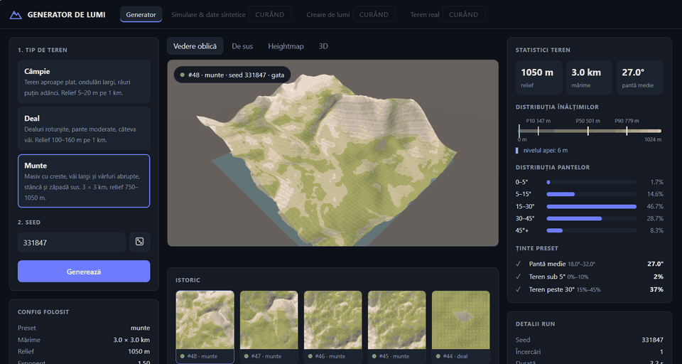
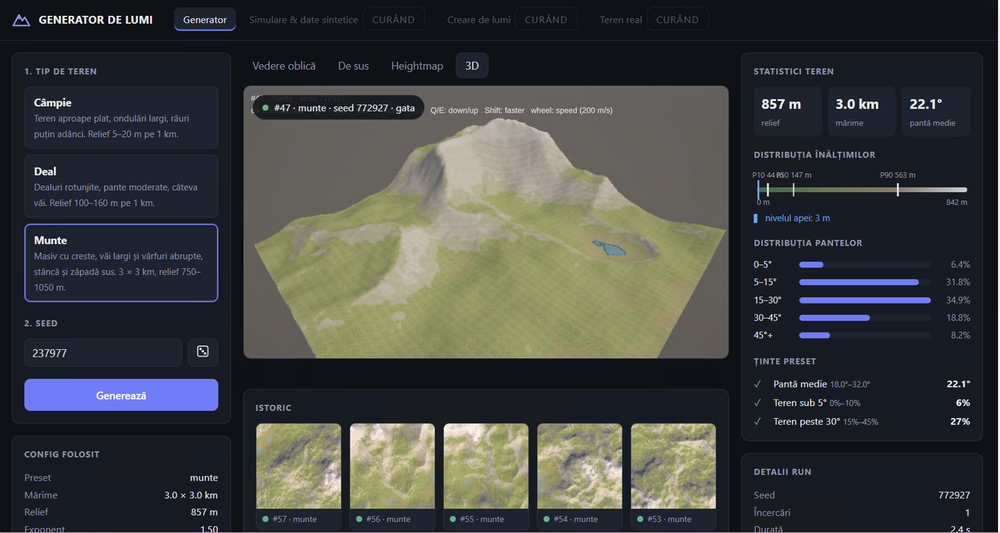
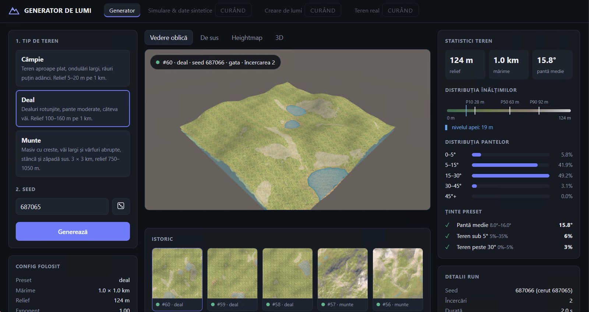
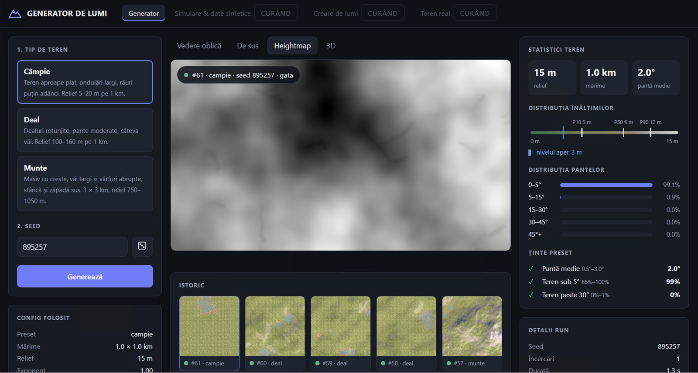

# Procedural World Generator

> 🚧 **Work in progress.** This is my bachelor's thesis project and it's being built step by step. Things will change, break and get better.

A procedural 3D terrain generator in **Unity**, controlled from an **ASP.NET Core** web app. Pick a terrain type, press generate, and a new world shows up with its images and measured statistics. Then fly through it in 3D.

<p align="center">
  
</p>

## What it does

- **Generates terrains from presets.** Mountain, hills and plain each run the same fixed pipeline (shape → erosion → water → textures) with different parameter ranges.
- **Reproducible worlds.** The same seed always gives exactly the same terrain, checked with a hash of the heightmap.
- **Measures the result.** Every run reports height statistics, mean slope, slope distribution and water level, so "looks good" becomes something you can check.
- **Rejects bad terrains.** A quality check compares the result against the preset's targets. If a terrain comes out flat or too steep, it's thrown away and regenerated with a new seed.
- **Web dashboard.** Settings on the left, the terrain in the middle, statistics on the right. Every run is saved with its config, images and metrics.
- **3D view.** Any finished run can be explored with a free-fly camera, right in the page.

### Mountain: flying through the terrain in the 3D tab


### Hills: oblique view, all preset targets passed on the second attempt


### Plain: heightmap and slope statistics


## How it works

```
 Web app (ASP.NET Core)                         Unity build (.exe)
 ─────────────────────                          ──────────────────
 user picks preset + seed
 preset ranges → config.json   ── starts ──►    reads config.json
                                                runs the pipeline:
                                                  Ridge / Voronoi / Perlin (fBM)
                                                  Normalize
                                                  Thermal + River erosion
                                                  Smooth
                                                  Water, Textures, Shoreline
 reads the run folder          ◄── writes ──    heightmap.raw, top.png, oblique.png,
 shows images + metrics                         preview.png, metrics.json, log.txt
 stores everything in SQLite                    exit code: 0 ok / 1 error / 2 rejected
```

The two halves never talk directly. They only share a JSON config and a run folder, so each side can change without breaking the other.

- **Pipeline of steps.** Each algorithm is a step (`IStep`) and the order is fixed. A preset only switches steps on or off and sets their values.
- **Relative layers.** Water, sand, rock and snow aren't fixed heights. They come from the generated terrain itself: water is a percentile of the heights, rock depends on slope, snow sits on the highest part. So they fit any relief.
- **Queue.** The site generates one terrain at a time and retries rejected ones automatically.

## Tech

**Unity 6** (C#, URP, Terrain API) · **ASP.NET Core 9** (minimal APIs, background worker) · **Entity Framework Core + SQLite** · HTML/CSS/JS

## Roadmap

- [x] Deterministic generation pipeline (same seed → same terrain)
- [x] Presets with parameter ranges and automatic quality checks
- [x] Web app with run queue, images and metrics
- [x] 3D fly-through of any run, inside the page
- [ ] Calibrating the presets on real elevation data (DEMs) from around the world
- [ ] Biomes and vegetation placement (Poisson-disc sampling)
- [ ] Mixed terrains (mountain + hills + valley on the same map)
- [ ] Describing the terrain you want in words and letting the app pick it

## Running it locally

> Setup is still rough while the project is in progress.

**Requirements:** Windows, Unity **6000.3.11f1**, .NET SDK **9.0**.

1. **Unity project** (`ProceduralWorldGenerator/`)
   - Open it in Unity 6000.3.11f1.
   - Import **[Editor GUI Table](https://assetstore.unity.com/packages/tools/gui/editor-gui-table-108795)** (free, Asset Store) into `Assets/GUITable/`. It's needed for the project to compile.
   - Texture, vegetation and water assets from the Asset Store aren't included, so without them the terrain looks grey. The generator still works.
   - Open `Assets/Generator.unity` and build it for Windows as `ProceduralWorldGenerator.exe`.
2. **Web app** (`TerrainSite/`)
   - In `appsettings.json`, set `Generator:ExePath` to your build and `Generator:DataDir` to a folder where runs will be saved.
   - Run `dotnet run` and open the address shown in the console.

---

Made by **Victoria** · bachelor's thesis, Faculty of Cybernetics, Statistics and Economic Informatics (ASE Bucharest)
